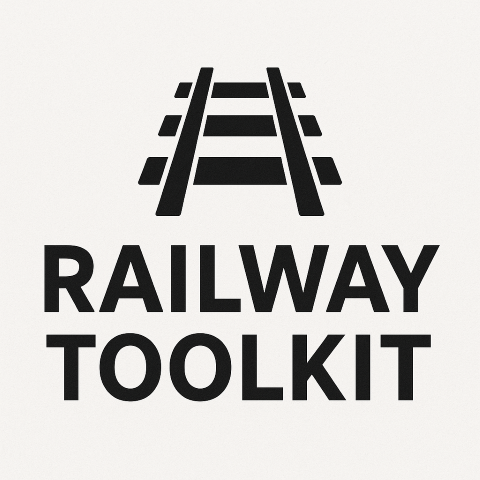

# Railway.Toolkit

<p align="center">
  
</p>

[](https://dotnet.microsoft.com/)
[](LICENSE)
[](src/Railway.Toolkit.Tests)

A functional programming toolkit for C# that implements railway-oriented programming with `Result<T>` types, enabling clean error handling and functional composition.

## What is Railway-Oriented Programming?

Railway-oriented programming is a functional approach to error handling that treats your program flow as a railway track with two rails:
- **Success Track** - Operations continue smoothly
- **Failure Track** - Errors are propagated without executing further operations

Once on the failure track, operations are skipped (short-circuited) until you explicitly handle the error. This eliminates the need for try-catch blocks and makes error handling explicit and composable.

[Learn more about Railway-Oriented Programming](https://fsharpforfunandprofit.com/rop/)

## Features

✨ **Core Features:**
- **Result<T> type** - Discriminated union for success/failure
- **Railway pattern** - Composable error handling without exceptions
- **Full async support** - All operations have async equivalents
- **Type-safe** - Compile-time guarantees with nullable reference types
- **Zero dependencies** - No external package dependencies
- **Fail-fast & validate-all patterns** - Choose your error aggregation strategy

🚀 **Operations:**
- **Map** - Transform success values
- **Bind** - Chain operations that return Results
- **Tap** - Side effects without breaking the chain
- **Ensure** - Validation with automatic track switching
- **Try** - Wrap exception-throwing code
- **Recover** - Handle errors and return to success track
- **Combine** - Work with multiple Results
- **Traverse/Sequence** - Collection operations

## Installation

```bash
# Using .NET CLI
dotnet add package Railway.Toolkit

# Using Package Manager
Install-Package Railway.Toolkit
```

## Quick Start

```csharp
using Railway.Toolkit;

// Simple validation pipeline
var result = Railway.Start(user)
    .Ensure(u => !string.IsNullOrEmpty(u.Email), "Email required", "INVALID_EMAIL")
    .Ensure(u => u.Age >= 18, "Must be 18 or older", "UNDERAGE")
    .Map(u => new ValidatedUser(u.Email, u.Age))
    .Match(
        ok => $"Welcome, {ok.Value.Email}!",
        fail => $"Validation failed: {fail.Error.Message}"
    );

// Async operations
var apiResult = await Railway.Start(userId)
    .BindAsync(FetchUserAsync)
    .MapAsync(user => user.ToDto())
    .TapAsync(dto => LogAsync(dto))
    .RecoverWith(Result.Ok(DefaultUserDto));
```

## Core Concepts

### Result<T>

The `Result<T>` type represents either success (`Ok`) or failure (`Fail`):

```csharp
// Create results
Result<int> success = Result.Ok(42);
Result<int> failure = Result.Fail<int>("Something went wrong", "ERROR_CODE");

// Pattern matching
var output = result.Match(
    ok => $"Success: {ok.Value}",
    fail => $"Error: {fail.Error.Message}"
);
```

### Railway.Start()

Begin a railway pipeline:

```csharp
var result = Railway.Start(initialValue)
    .Map(x => x * 2)
    .Bind(Validate)
    .Tap(x => Console.WriteLine($"Value: {x}"));
```

### Error Handling

```csharp
// Create errors
var error = Error.Create("Not found", "NOT_FOUND");
var errorWithException = Error.FromException(ex);

// Aggregate multiple errors
var errors = new[] { error1, error2, error3 };
var aggregated = Error.Aggregate(errors, "Multiple errors occurred");
```

## API Reference

### Map - Transform Values

Transform success values without changing the Result type:

```csharp
Result<int> result = Result.Ok(5);

// Sync
var doubled = result.Map(x => x * 2);

// Async
var formatted = await result.MapAsync(async x =>
{
    await Task.Delay(100);
    return x.ToString();
});
```

### Bind - Chain Operations

Chain operations that return Results:

```csharp
Result<int> ValidatePositive(int value) =>
    value > 0
        ? Result.Ok(value)
        : Result.Fail<int>("Must be positive", "NEGATIVE");

var result = Railway.Start(5)
    .Bind(ValidatePositive)
    .Bind(x => Result.Ok(x * 2));

// Async
var asyncResult = await Railway.Start(5)
    .BindAsync(ValidatePositiveAsync)
    .BindAsync(x => SaveToDbAsync(x));
```

### Tap - Side Effects

Execute side effects without breaking the chain:

```csharp
var result = Railway.Start(42)
    .Tap(x => Console.WriteLine($"Value: {x}"))
    .TapError(e => LogError(e))
    .Map(x => x * 2);

// Async
await result
    .TapAsync(async x => await LogAsync(x))
    .TapErrorAsync(async e => await AlertAsync(e));
```

### Ensure - Validation

Add validation that switches to failure track if predicate fails:

```csharp
var result = Railway.Start(age)
    .Ensure(x => x >= 0, "Age cannot be negative", "INVALID_AGE")
    .Ensure(x => x <= 120, "Age unrealistic", "INVALID_AGE")
    .Map(x => new Person(x));

// Async predicates
await result.EnsureAsync(
    async x => await IsUniqueEmailAsync(x),
    "Email already exists",
    "DUPLICATE_EMAIL"
);

// Validate all - collect all validation errors
var errors = inputs.TraverseAll(Validate)
    .Match(
        ok => "All valid!",
        fail => string.Join(", ", fail.Error.InnerErrors!.Select(e => e.Message))
    );
```

### Try - Exception Handling

Wrap exception-throwing code:

```csharp
// Wrap a function
var result = ResultTryExtensions.Try(() =>
    int.Parse("not a number")
);

// Wrap an action (returns Result<Unit>)
var unitResult = ResultTryExtensions.Try(() =>
{
    File.WriteAllText("file.txt", "content");
});

// Use in pipeline
var parsed = Railway.Start(input)
    .TryMap(x => int.Parse(x))
    .TryBind(x => ValidateAndSave(x));

// Async
await ResultTryExtensions.TryAsync(async () =>
{
    await httpClient.PostAsync(url, content);
});
```

### Cancellation

The asynchronous-delegate overloads of `BindAsync`, `MapAsync`, `EnsureAsync`, and
`TapAsync` accept a required `CancellationToken` on both `Result<T>` and
`Task<Result<T>>`. `TryAsync` (functions and actions), `TryMapAsync`, `TryBindAsync`,
`TraverseAsync`, and `TraverseAllAsync` also accept token-aware delegates. The
delegate receives the exact governing token as its final argument. Return types
remain `Task`.

```csharp
Task<int> FetchAsync(int id, CancellationToken token) =>
    Task.FromResult(id + 1);

Task<Result<int>> SaveAsync(int value, CancellationToken token) =>
    Task.FromResult(Result.Ok(value));

Result<int> result = await Result.Ok(1)
    .MapAsync(FetchAsync, cancellationToken)
    .BindAsync(SaveAsync, cancellationToken)
    .EnsureAsync((value, token) => Task.FromResult(value > 0),
        Error.Create("Value must be positive", "Validation.Positive"), cancellationToken)
    .TapAsync((value, token) => Task.CompletedTask, cancellationToken);

Result<string> text = await ResultTryExtensions.TryAsync(
    token => httpClient.GetStringAsync(url, token), cancellationToken, "Http.Fetch");
```

Supply the token after the delegate and required operation arguments. For Try
methods it precedes the optional `errorCode`. Explicit `default` or
`CancellationToken.None` is supported; the token parameter is never optional.

Argument validation runs first. On a successful input, Railway checks the token
before invoking the delegate and forwards it unchanged. A directly supplied
`Result.Fail` skips success-track work without checking cancellation. Incoming
result tasks are awaited normally, then cancellation is checked before processing
either `Ok` or `Fail`. After normal delegate completion, Railway checks again
before processing the result or creating output from a value, Boolean, or void
completion. Work that ignores cancellation is awaited to completion; requested
cancellation then prevents output. Completed side effects are not rolled back.

Traversal checks before obtaining the enumerator, before each `MoveNext`, before
the selector, after each normal selector await, and after enumeration and disposal.
Cancellation returns no collected values or errors, including on the last item.
`TraverseAllAsync` retains ordinary error aggregation.

`SequenceAsync` and `SequenceAllAsync` accept a required token after their task
enumerable. They check before obtaining the enumerator and each `MoveNext`.
Lazy enumeration can start a task: every yielded task is awaited normally even
if enumeration requested cancellation, then cancellation is checked before either
result track is processed. A final check follows enumeration and disposal.

`CombineAsync` and `CombineAllAsync` take the token before their `params` tasks:

```csharp
Task<Result<int>> first = LoadAsync(1, cancellationToken);
Task<Result<int>> second = LoadAsync(2, cancellationToken);
Result<IReadOnlyList<int>> combined = await ResultCombineExtensions.CombineAsync(
    cancellationToken, first, second);
Result<int> sum = await first.ZipAsync(second,
    (a, b, token) => a + b, cancellationToken);
```

Combine checks cancellation before awaiting `Task.WhenAll`, awaits every supplied
task normally, and checks again before combining the returned results. Ordinary
faults retain `Task.WhenAll` behaviour. The `All` forms collect railway errors;
the other forms return the first railway error in input order.

Zip accepts the token after its second task, or after its synchronous selector.
It awaits the first task normally and checks cancellation before advancing to
the second await, then checks again before result processing. This also means a
pre-cancelled token does not abandon the first await. The selector runs only for
two successful inputs, receives the same token, and has checks before invocation
and after normal return. Its exceptions propagate.

Pass the governing token when creating supplied tasks. Railway cannot add work
cancellation to a task after creation. Sequence stops enumeration when it stops;
Zip may stop before awaiting its second task. The caller owns already-started
siblings not reached, including observing their later faults. Combine awaits all
siblings through `WhenAll`. No operation cancels only the wait, forcibly stops
work, or returns a partial result on cancellation. Required disposal still runs.

Non-Try methods propagate every `OperationCanceledException`. Token-aware Try
methods propagate it when the governing token is requested at the catch boundary;
otherwise they convert it through `Error.FromException`, retaining the exception
and supplied error code. Exception-token identity is not compared. This includes
linked and unrelated tokens: the governing token's state decides. An unrequested
`TaskCanceledException`, such as a timeout, becomes a failure. With `default` or
`CancellationToken.None`, every cancellation exception at a Try boundary becomes
a failure. Ordinary exceptions retain the existing Try conversion behaviour,
even when the governing token is requested. The post-await check applies only to
normal completion; it does not overwrite a converted exception with cancellation.

Propagated cancellation emits no Railway operation log. Converted Try failures
use normal failure logging. Existing tokenless overloads remain supported and
continue to propagate every `OperationCanceledException`, including in Try methods.
Choosing a token-aware Try overload therefore intentionally changes unrequested
cancellation into a failure.

### Error handling, matching, and synchronous callbacks

`MapErrorAsync` and `TapErrorAsync` accept token-aware async callbacks on both
`Result<T>` and `Task<Result<T>>`. Cancellation may skip error transformation or
diagnostic callbacks. A direct Ok bypasses these callbacks and cancellation checks.
An incoming task is awaited normally, then cancellation wins over either track.

Task receivers also accept token-aware synchronous callbacks for `BindAsync`,
`MapAsync`, `EnsureAsync`, `TapAsync`, `MapErrorAsync`, and `TapErrorAsync`.
The token is checked before invocation and after a normal return; synchronous
work cannot be interrupted. `EnsureAsync` places its Error argument before the token.

`MatchAsync` supports two async token-aware handlers on direct Results and Task
receivers, and two synchronous token-aware handlers on Task receivers. Handlers
receive the `Result<T>.Ok` or `Result<T>.Fail` case and the governing token. Only
the selected handler runs, and cancellation may skip either handler. Both handlers
are required. No new ValueTask or mixed handler forms are provided.

```csharp
Result<int> handled = await incoming
    .MapErrorAsync((error, token) => Task.FromResult(error), cancellationToken)
    .TapErrorAsync((error, token) => WriteDiagnosticAsync(error, token), cancellationToken);

string message = await handled.MatchAsync(
    (ok, token) => FormatSuccessAsync(ok.Value, token),
    (fail, token) => FormatFailureAsync(fail.Error, token), cancellationToken);
```

These overloads require a final governing token and forward it unchanged. They
check cancellation after normal awaits and callback returns before producing output.
Ordinary faults propagate, even if cancellation was also requested. Existing
tokenless overloads preserve their behaviour.

### Finally always runs

**Behaviour change:** both Task-receiver `FinallyAsync` overloads now run cleanup
after Ok, Fail, an incoming exception, or incoming cancellation, just like C#
`finally`. Cleanup runs once after the incoming task completes and is awaited
normally. Request cancellation cannot skip it.

After successful cleanup, the original result, exception, or cancellation continues.
If cleanup itself throws or cancels, its exception takes precedence, just as in
C# `finally`. Review existing cleanup callbacks because they now execute after
incoming exceptions and cancellation too.

Cleanup remains tokenless; no pipeline token is forwarded to it. Applications that
need a cleanup timeout control it explicitly inside their callback. Required resource
disposal still runs, and no output-result log is emitted for exceptions or cancellation.

### Recover - Error Recovery

Return to success track after error:

```csharp
var result = Railway.Start(userId)
    .Bind(FetchUser)
    .Recover(GetDefaultUser()) // Use default on failure
    .RecoverWith(error =>
        error.Code == "NOT_FOUND"
            ? Result.Ok(GuestUser)
            : Result.Fail<User>(error)
    );
```

### Combine - Multiple Results

Work with multiple Results:

```csharp
// Zip two results
var combined = result1.Zip(result2, (a, b) => a + b);

// Combine multiple (fail-fast)
var all = ResultCombineExtensions.Combine(result1, result2, result3);

// Combine all (collect all errors)
var validated = ResultCombineExtensions.CombineAll(
    ValidateName(name),
    ValidateEmail(email),
    ValidateAge(age)
).Match(
    ok => "All valid!",
    fail => $"Errors: {string.Join(", ", fail.Error.InnerErrors!.Select(e => e.Message))}"
);
```

### Traverse & Sequence - Collections

Transform collections of values or Results:

```csharp
// Traverse - map and collect (fail-fast)
var numbers = new[] { 1, 2, 3, 4, 5 };
var results = numbers.Traverse(x =>
    x % 2 == 0
        ? Result.Ok(x)
        : Result.Fail<int>("Odd number", "ODD")
);

// TraverseAll - collect all errors
var validated = inputs.TraverseAll(Validate);

// Sequence - flip List<Result<T>> to Result<List<T>>
var results = new[] { Result.Ok(1), Result.Ok(2), Result.Ok(3) };
var sequenced = results.Sequence(); // Result<List<int>>

// Async
await urls.TraverseAsync(async url => await FetchAsync(url));
```

## Advanced Patterns

### Validation Pipeline

```csharp
public record User(string Email, string Name, int Age);
public record ValidatedUser(string Email, string Name, int Age);

public Result<ValidatedUser> ValidateUser(User user)
{
    return Railway.Start(user)
        .Ensure(u => !string.IsNullOrEmpty(u.Email), "Email required", "EMAIL_REQUIRED")
        .Ensure(u => u.Email.Contains("@"), "Invalid email format", "INVALID_EMAIL")
        .Ensure(u => !string.IsNullOrEmpty(u.Name), "Name required", "NAME_REQUIRED")
        .Ensure(u => u.Age >= 18, "Must be 18 or older", "UNDERAGE")
        .Ensure(u => u.Age <= 120, "Invalid age", "INVALID_AGE")
        .Map(u => new ValidatedUser(u.Email, u.Name, u.Age));
}
```

### API Request Pipeline

```csharp
public async Task<Result<UserDto>> GetUserAsync(int userId)
{
    return await Railway.Start(userId)
        .Ensure(id => id > 0, "Invalid user ID", "INVALID_ID")
        .BindAsync(id => FetchUserFromDbAsync(id))
        .TapAsync(user => LogAsync($"Fetched user {user.Id}"))
        .Ensure(user => user.IsActive, "User is inactive", "INACTIVE_USER")
        .MapAsync(user => MapToDtoAsync(user))
        .RecoverWith(error =>
            error.Code == "NOT_FOUND"
                ? Result.Ok(GetGuestDto())
                : Result.Fail<UserDto>(error)
        );
}
```

### Batch Processing

```csharp
// Process all items, collect all errors for reporting
var items = new[] { item1, item2, item3, item4 };

var results = await items.TraverseAllAsync(async item =>
    await Railway.Start(item)
        .BindAsync(ValidateAsync)
        .BindAsync(ProcessAsync)
        .BindAsync(SaveAsync)
);

return results.Match(
    ok => $"Successfully processed {ok.Value.Count} items",
    fail => $"Failed with {fail.Error.InnerErrors!.Count} errors:\n" +
            string.Join("\n", fail.Error.InnerErrors.Select(e => $"- {e.Message}"))
);
```

## Testing

The library includes comprehensive tests with 100% coverage:

```bash
# Run all tests
dotnet test

# Run by category
dotnet test --filter Category=Core
dotnet test --filter Category=Map
dotnet test --filter Category=Async

# Run only async tests
dotnet test --filter "FullyQualifiedName~Async"
```

**Test Categories:**
- `Core` - Error and Result types
- `Map` - Map operations
- `Bind` - Bind operations
- `Tap` - Side effects
- `Validation` - Ensure operations
- `Error` - Error handling and recovery
- `Try` - Exception wrapping
- `Combine` - Combining results
- `Collection` - Collection operations
- `MonadLaws` - Monad and functor laws
- `Railway` - Railway pattern concepts
- `Unit` - Unit type

**Stats:**
- 166 total tests
- 35 async tests
- 100% pass rate
- All monad laws verified

## Design Philosophy

### No Escape Hatches

Railway.Toolkit intentionally does not provide "escape hatch" methods like:
- ❌ `IsOk` / `IsFail` properties
- ❌ `GetValueOrDefault()` methods
- ❌ `Unwrap()` or similar

**Why?** These methods encourage falling back to imperative patterns and defeat the purpose of railway-oriented programming. Instead, use:
- ✅ `Match()` - Handle both success and failure cases
- ✅ `Recover()` - Provide defaults functionally
- ✅ `Map/Bind` - Stay on the railway

### Explicit Async

All async methods use the `Async` suffix explicitly:
- `MapAsync`, `BindAsync`, `TapAsync`, etc.

This makes it clear at the call site that async operations are involved and prevents accidental blocking.

### Fail-Fast vs Validate-All

The library provides both patterns:
- **Fail-fast** - `Traverse`, `Sequence`, `Combine` - Stop at first error
- **Validate-all** - `TraverseAll`, `SequenceAll`, `CombineAll` - Collect all errors

Use fail-fast for control flow, validate-all for user-facing validation where you want to show all errors at once.

## Examples Repository

See the [examples folder](./examples) for complete working examples:
- User registration with validation
- API request handling
- Database operations
- Batch processing
- Error recovery strategies

## Development Approach

This library is developed with the assistance of [Claude](https://claude.ai) (Anthropic's AI assistant) as a coding tool.

In the interest of transparency: AI-assisted development can produce low-quality or unsafe code ("slop") when used without oversight. To mitigate this, every commit is reviewed by the author — a .NET developer with 20 years of experience — before it is merged. The AI assists with implementation speed; the human is responsible for correctness, design quality, and safety.

If you spot anything that doesn't meet the bar, please open an issue.

## Contributing

Contributions are welcome! Please:
1. Fork the repository
2. Create a feature branch
3. Add tests for new functionality
4. Ensure all tests pass
5. Submit a pull request

## License

MIT License - see [LICENSE](LICENSE) file for details.

## Acknowledgments

- Inspired by [Railway Oriented Programming](https://fsharpforfunandprofit.com/rop/) by Scott Wlaschin
- Influenced by F#'s Result type and Rust's Result/Option types
- Built for the C# community with love ❤️

---

**Built with functional programming principles • Zero dependencies • 100% test coverage**
